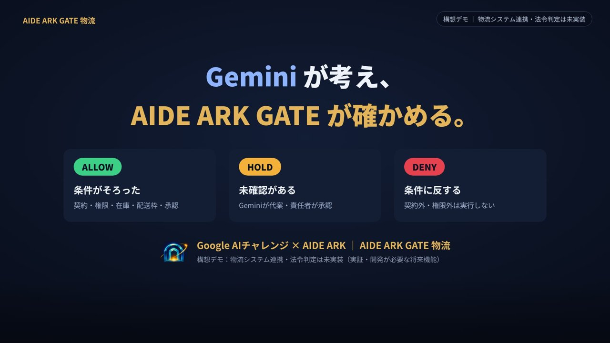
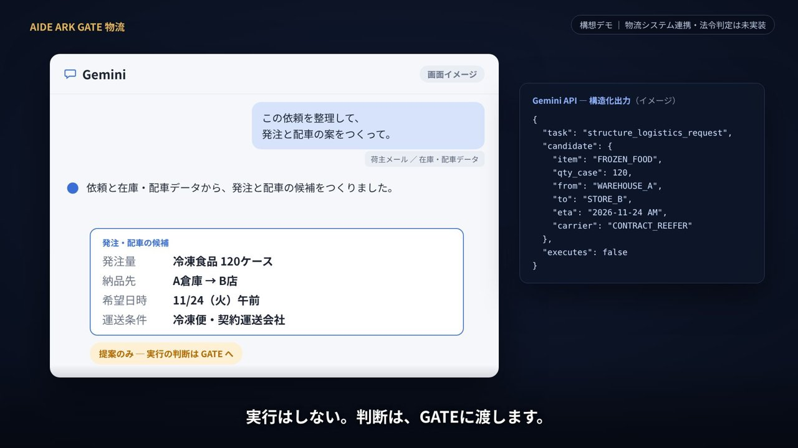
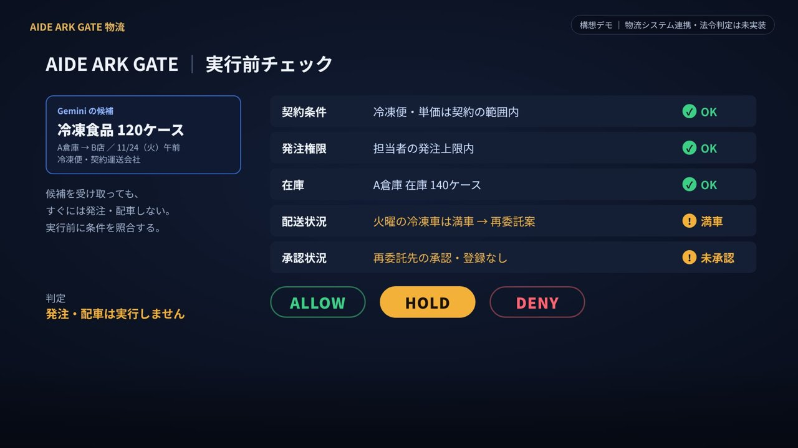
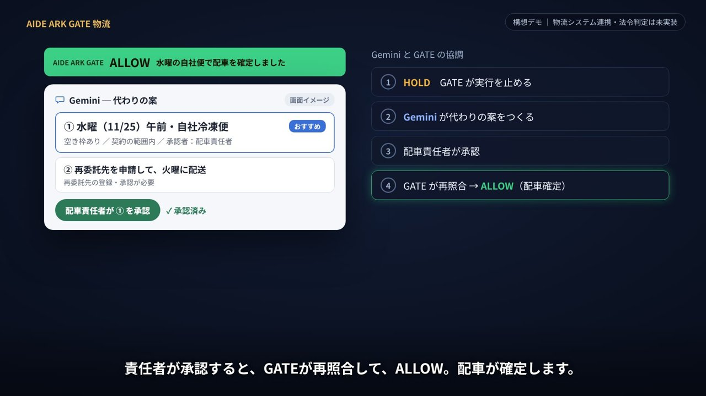
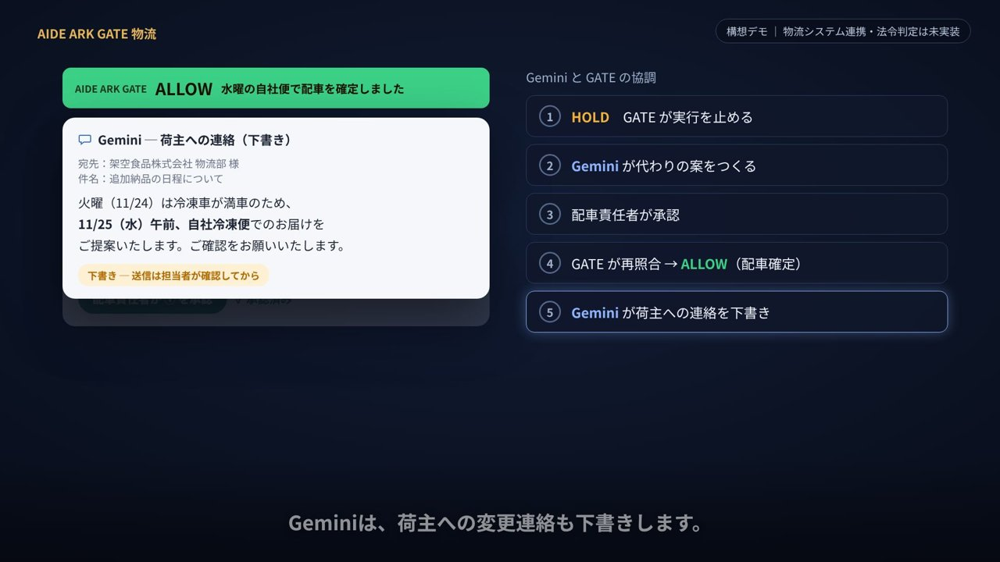

# AIDE ARK GATE 物流 ― Geminiと協調する、実行前の安全ゲート

> **Geminiが考え、AIDE ARK GATEが確かめる。**

AIが作成した発注・配車案を、**実行前に確認して制御する**物流向けの実行ゲートの構想です。
Google AIチャレンジ（はたらく・まなぶ部門）応募作品。

> ⚠️ **構想デモです。** 物流システム連携・法令判定は未実装で、実証・開発が必要な将来機能です。
> 本リポジトリの荷主・品目・数量・事業者・データはすべて架空のサンプルです。

---

## 概要

Geminiが物流の依頼から発注・配車案をつくり、AIDE ARK GATEが契約・権限・在庫・承認を照合して、実行前に **ALLOW／HOLD／DENY** で判定します。止めた案も、Geminiの代案と責任者の承認で前に進めます。

| 判定 | 意味 | 次の動き |
|---|---|---|
| **ALLOW** | 条件がそろった | 実行する |
| **HOLD** | 未確認・不足がある | Geminiが代案を出し、責任者が承認 → GATEが再照合 |
| **DENY** | 条件に反する（契約外・権限外など） | 実行しない |

## 役割分担

| | Gemini | AIDE ARK GATE | 人（担当者・責任者） |
|---|---|---|---|
| 依頼の読み取り・候補の作成 | ✅ | | |
| 実行してよいかの判定 | | ✅（独立して判定） | |
| HOLD時の代わりの案 | ✅ | 再照合 | 承認 |
| 関係者への連絡 | 下書き | | 確認して送信 |

Geminiの出力は常に「候補」です。Geminiに発注・配車・支払いを実行する権限はありません。

## デモのストーリー

1. **依頼**：荷主から「11/24（火）午前、A倉庫→B店へ冷凍食品120ケース、いつもの冷凍便で」とメールが届く
2. **Geminiが候補をつくる**：発注量・納品先・希望日時・運送条件を構造化（`executes: false`）
   
3. **GATEが照合 → HOLD**：契約・権限・在庫はOK。火曜の冷凍車は満車、再委託先は未承認
   
4. **Geminiが代案 → 承認 → ALLOW**：水曜午前の自社冷凍便を提案。責任者が承認し、GATEが再照合して配車確定
   
5. **Geminiが荷主への連絡を下書き**：送信は担当者が確認してから
   

## 利用場面

| 場面 | GATEが確認する内容 |
|---|---|
| 在庫発注 | 発注量、在庫状況、承認権限、契約条件 |
| 配車・配送変更 | 運送会社、委託条件、納品先・日時、再委託情報 |
| 運賃支払い | 請求内容、発注・配送記録、支払権限、確認状況 |
| 倉庫作業指示 | 対象在庫、作業内容、現場状態、担当者の権限 |

**主な顧客**：荷主、メーカー、物流事業者、3PL、倉庫事業者、TMS・WMSベンダー

**進め方**：対象業務を一度に広げず、まず一つの操作を選び、業務システムと接続して実証します。

## ファイル構成

| ファイル | 内容 |
|---|---|
| `01_structure_request.md` | Geminiプロンプト：依頼 → 候補（構造化出力） |
| `02_alternative_plan.md` | Geminiプロンプト：HOLD理由 → 代わりの案 |
| `03_shipper_message.md` | Geminiプロンプト：確定内容 → 荷主への連絡下書き |
| `shipper_email.txt` | 架空の荷主メール |
| `business_data.json` | 架空の業務データ（在庫・配車枠・契約・権限・承認） |
| `gemini_candidate.json` | Geminiの候補（出力例） |
| `gate_check_hold.json` | GATEの照合結果（HOLD）の例 |
| `gemini_alternatives.json` | Geminiの代案（出力例） |
| `gate_check_allow.json` | 再照合結果（ALLOW）の例 |
| `gate_checks.md` | 照合項目と判定の流れ |
| `01〜05_*.jpg` | デモ動画の画面 |

## 実装状況

| 項目 | 状況 |
|---|---|
| Geminiによる依頼の構造化・代案・連絡下書き | プロンプトで試行可能（本リポジトリのプロンプト） |
| GATEの照合・ALLOW／HOLD／DENY判定 | 構想（サンプルデータで流れを示す） |
| TMS・WMS等の物流システム連携 | 未実装（実証・開発が必要な将来機能） |
| 法令判定 | 未実装（実証・開発が必要な将来機能） |

## 開発

**AIDE ARK Inc.**（研究部門：AIDE PROJECT）

AI Can Propose. Execution Requires Independent Authorization.

---

© 2026 AIDE ARK Inc. All rights reserved.
本リポジトリの内容の無断転載・商用利用を禁じます。関連技術は特許出願中です。
